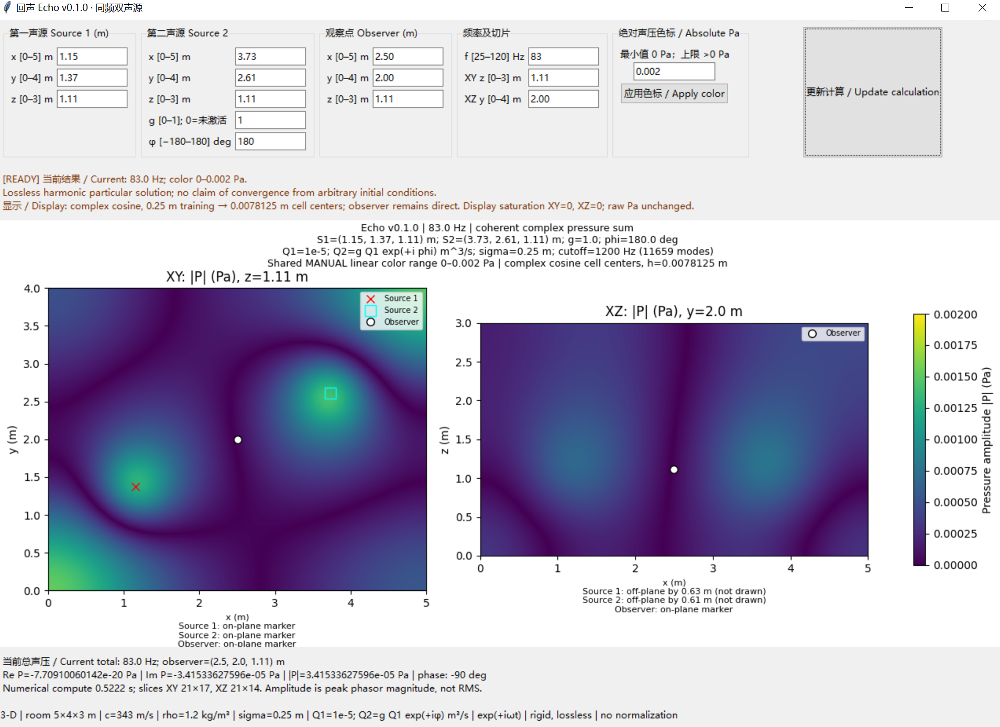
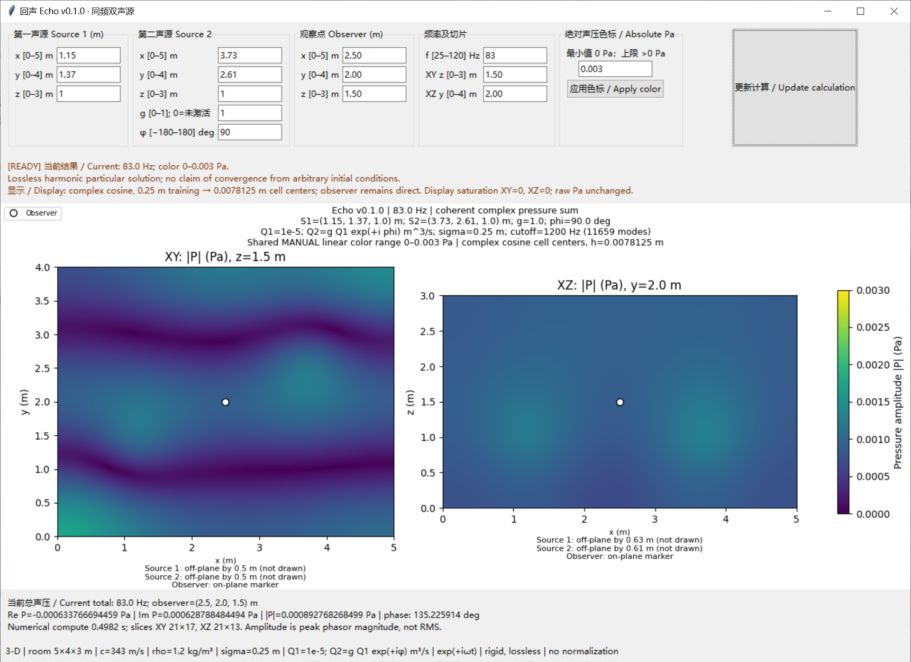

# 回声 Echo v0.1.0

同频双声源声场探索工具，Python / Tk 桌面 GUI。

v0.1.0 为源码发行版，不包含 EXE。发布前 GUI 已获所有者人工验收。项目代码采用 [MIT License](LICENSE)，Copyright (c) 2026 local-usr-bin。第三方依赖各自保留原许可证，见 [NOTICE.md](NOTICE.md)。

## 软件定位

在固定的 5×4×3 m 理想刚性、无损矩形房间内，观察两个同频平滑单极子源的复声压叠加。它用于理解有限模态模型中的相位、干涉及空间分布，不是真实房间或扬声器的预测/测量认证工具。

主要功能：

- 两组声源 XYZ、第二源相对幅值 g 和相对相位 φ；g=0 时退化为单声源。
- 一个共同频率，正式输入 25–120 Hz。
- 可调整的 XY / XZ 双切面、在面/离面与未激活标记。
- 两图共用一个位于绘图区外、Figure 内的图例；按 Source 1、Source 2、Observer 顺序对实际绘制的标记去重。两面均出现的 Observer 只列一次，未绘制的类别不显示，g=0 时不显示 Source 2。
- 共享的手动绝对 Pa 色标及超限提示。
- 观察点直接三维级数计算的总复声压、幅值和有条件的相位读数。
- 输入校验、参数待更新、更新计算、应用色标与正常关闭。

图中的 |P| 是复声压相量幅值（Pa），不是 RMS 或 dB SPL。1200 Hz 是物理级数的模态截断，不是 GUI 输入上限。完整模型及共振、相消、显示精度边界见 [MODEL-AND-LIMITS.md](MODEL-AND-LIMITS.md)。

## 环境要求

已核验的环境为 Windows 10 x64、64 位 Python 3.12.16、Tcl/Tk 8.6.15、NumPy 2.3.5、Matplotlib 3.10.8 和 requirements.txt 中的其余版本。

运行入口要求 Python 3.12。所选 Python 还必须包含 tkinter 及可用的原生 Tcl/Tk；tkinter 不是通过 requirements.txt 安装的包。建议使用带 Tk 组件的 Python 3.12，或已准备好相应组件的独立 Conda 环境。Anaconda/Conda 不是 Echo 随包附带的依赖，也不要求特定安装位置。

已在同一台 Windows 电脑上建立不继承系统包的独立 Python 3.12 venv，重新安装 requirements.txt 的 11 项运行依赖；这项验证不复用原环境的 site-packages。Python/Tk 底层运行时仍来自该电脑已有的 Python 3.12 构建，不等于在全新 Windows 机器上验证。其他 Python/Tk 构建、操作系统及所有显示模式尚未得到兼容承诺。

## 安装依赖与启动

以下为 Windows PowerShell 操作示例，在本目录打开终端后执行。它会在当前目录创建独立虚拟环境；如果已有合适环境，也可以直接使用那个环境的 Python。

```powershell
py -3.12 -m venv .venv
.\.venv\Scripts\python.exe -m pip install -r requirements.txt
.\.venv\Scripts\python.exe run_echo.py
```

不必激活环境，也不必修改全局 PATH。若使用已有环境，请明确调用该环境的 Python：

```powershell
python run_echo.py
```

上面的 python 必须是所选 Python 3.12 环境；直接使用其 python.exe 完整路径亦可。入口根据自身位置定位源码，从其他工作目录启动也不需要复制审计材料。需要可用的桌面会话。

requirements.txt 只列 11 项运行包的版本，不含 pip、环境管理器或原生 DLL；它不是带哈希和平台构建约束的完整安装锁。requirements-audited.txt 仅原样记录既有环境快照，其中的 pip 不属于 Echo 运行导入闭包，请勿将该参考文件作为安装指令。

## 缓存与目录写入

Windows 默认运行目录为当前用户 LocalAppData 下的 Echo/v0.1.0；临时文件、通用缓存和 Matplotlib 配置分别存放其中。入口不要求源码目录可写，也不写入永久环境变量或注册表。

可通过当前进程的 ECHO_CACHE_DIR 指定其他可写运行目录，例如：

```powershell
$env:ECHO_CACHE_DIR = Join-Path $env:LOCALAPPDATA 'Echo-custom-cache'
python run_echo.py
```

此设置只影响当前终端启动的进程。不要把它设为源码目录或私人审计目录。入口中其他平台的缓存定位分支不代表已完成那些平台的 GUI 验收。

## 操作提示

默认第二源 g=0，表示未激活。调整源、观察点、频率或切面后，旧场清空并显示待更新，点击“更新计算”。修改色标上限后点击“应用色标”；它仅改变映射，不改变复声压或直接观察点读数。

两源共用频率；相位输入为角度，运算时转为弧度。两源先按复数相加，再取幅值，不自动调整总源强。

精确/数值共振被拒绝求值；近共振会警告。零声压的相位无定义，数值近零时可能不显示确定相位，原始复值仍保留。

## 截图





## 验证与使用范围

模型、复 DCT-I 显示和双源契约继承冻结 P1-A。历史工程验证及发行前有限入口/回归检查都不等于真实房间实验验证，也不保证任意参数、任意位置满足统一误差。

既有所有者显示检查覆盖：

| 模式 | 证据范围 |
|---|---|
| 3840×2160、Windows 150% | 冻结版本已有人工验收 |
| 2560×1440、125% | 在同一 4K 电视上切换模式验收，不是原生 2K 显示器全面认证 |

表中的显示模式是继承的冻结版证据；本源码版的所有者 GUI 验收没有新增显示器或 DPI 兼容承诺。1080p、720p、所有 DPI、多屏和特殊高 DPI 不作承诺。当前默认/最小布局及轻微交互卡顿继承原验收范围，没有为发行调整精度或优化架构。MODEL-AND-LIMITS.md 中的候选体验状态是该文档编写时的历史记录，当前人工验收状态以本 README 的说明为准，模型及科学限制保持不变。

v0.1.0 仅提供源码，不包含 EXE、安装器、自动更新、第三方 DLL、字体或 Python 环境。正式功能为上述同频双声源与相位控制，没有扩频、异频双源、损耗模型或额外声学功能。
